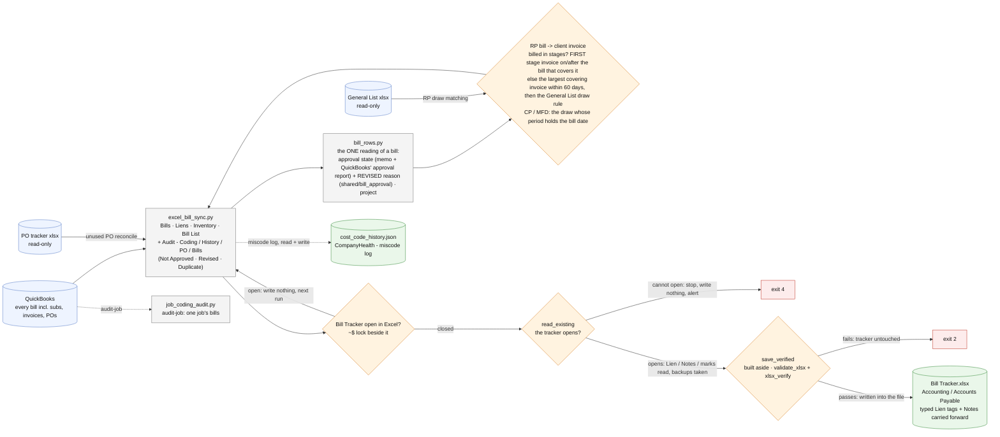

# bill-tracker/ - how the AP run works

Last changed: 10/16/2026 - **the clerks' typing can no longer be wiped**: the tracker is opened ONCE (`read_existing`, shared/xlsx_read); a tracker that exists but cannot be opened stops the run (exit 4, nothing written, the server alerts) instead of reading as "no Lien / Notes / marks" and being saved over. Backups copy only a tracker that just opened: `_backups/Bill Tracker - previous.xlsx` (just before this run) + the day's FIRST dated copy (no longer overwritten every run). The save goes through `shared/xlsx_save.save_verified` (built aside, `validate_xlsx` + `xlsx_verify`, then written into the file, permissions kept); a failed check writes nothing (exit 2) - it used to save the bad file anyway. Earlier: 10/14/2026 - **RP stage-invoice match**: on a job billed in stages (`shared/rp_invoicing`) a bill goes to the FIRST stage invoice dated on/after it that covers it (basis `stage`), before the largest-cover rule (RP7597 K783197 case). Same day: **Approved is one icon** on Bills + Inventory (green check / red cross / amber `?` for check QBO; `shared/bill_approval.state_icon`, the ledger loader maps it back to the word). Same day: the Bills and Inventory sheets gain a **Bill Memo** column right after Line Description (the bill's PrivateNote, one line, the same on every line of the bill; the bill-grain collapse now carries it; the Bill List already had it); column widths are keyed by header name so an inserted column never shifts them. Earlier: 10/13/2026 - the Bill List's Approved column gains **pending approval / requires approval** from QuickBooks' approval report (`shared/bill_approval.current()`, read once per run; the run prints when the report synced); a bill the fresh report does not list is approved; the stale-approval audit counts the queued bills too. Earlier: 10/12/2026 - first chart for this tool. The REVISED-bill follow-up built here this morning moved the same day into the statement reconciler (owner: "in the same statement Excel, not a mix"); `bill_rows.revised_reason` now lives in `shared/bill_approval` (re-exported) so both tools read the REVISED memo line the same way.

Update this chart - and the line above - in the same commit as any change to `bill-tracker/`
(`.github/flow_guard.sh`). The full system map is `docs/ARCHITECTURE.md`.

Runs on the office server every 15 minutes (docker/scheduler.py, AP then AR) while the writer file names the
server; the Mac's `sync-ap` stands down.
