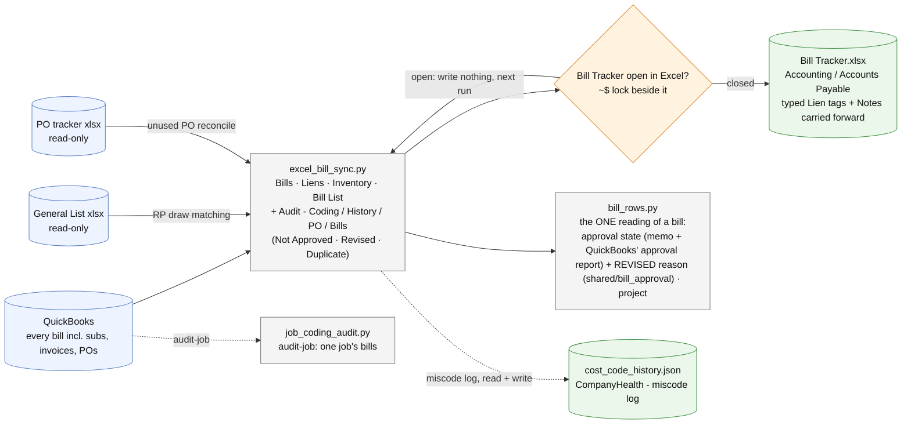

# bill-tracker/ - how the AP run works

Last changed: 10/13/2026 - the Bill List's Approved column gains **pending approval / requires approval** from QuickBooks' approval report (`shared/bill_approval.current()`, read once per run; the run prints when the report synced); a bill the fresh report does not list is approved; the stale-approval audit counts the queued bills too. Earlier: 10/12/2026 - first chart for this tool. The REVISED-bill follow-up built here this morning moved the same day into the statement reconciler (owner: "in the same statement Excel, not a mix"); `bill_rows.revised_reason` now lives in `shared/bill_approval` (re-exported) so both tools read the REVISED memo line the same way.

Update this chart - and the line above - in the same commit as any change to `bill-tracker/`
(`.github/flow_guard.sh`). The full system map is `docs/ARCHITECTURE.md`.

Runs on the office server every 15 minutes (docker/scheduler.py, AP then AR) while the writer file names the
server; the Mac's `sync-ap` stands down.
