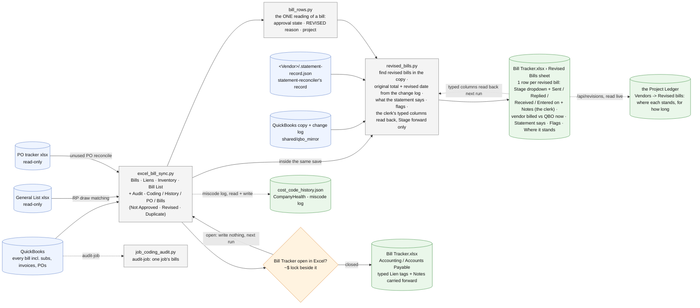

# bill-tracker/ - how the AP run works

Last changed: 10/12/2026 - NEW `revised_bills.py`, the REVISED-bill follow-up as a process (AP-13), inside the Bill Tracker (owner: "it's only the Excel"): every AP run rebuilds the **Revised Bills** sheet (`shared/revised_sheet`, an Excel Table) in the tracker's own save - each PM-revised bill in the QuickBooks copy (the `REVISED - <reason>` memo line), its original total and when the PM changed it (the change log), what the vendor's latest statement says (the reconciler's record), the pickles (entered twice · amount changed again after the clerk sent it · paid before re-issued · gone from QuickBooks), where it stands in plain words; the clerk types Stage (a dropdown) + Sent / Replied / Received / Entered on + Notes, read back before every rebuild like the Lien tags; the ledger reads the sheet (Vendors -> Revised bills). First chart for this tool.

Update this chart - and the line above - in the same commit as any change to `bill-tracker/`
(`.github/flow_guard.sh`). The full system map is `docs/ARCHITECTURE.md`.

Runs on the office server every 15 minutes (docker/scheduler.py, AP then AR) while the writer file names the
server; the Mac's `sync-ap` stands down. `python3 bill-tracker/revised_bills.py` previews the sheet by hand
(`--xlsx [PATH]` rebuilds a workbook's sheet; `--since` widens the scan).
