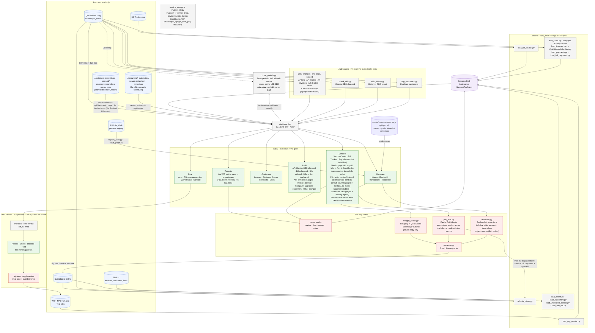

# ledger/ - how the Project Ledger works

Last changed: 10/13/2026 (last) - **a bill payment to a set amount + the credit on the stub** (owner: "create a bill payment to a certain amount and ... show the credit it made ... joint check pays a bill we paid"): Pay in QuickBooks' vendor band gets an Amount box - the bills less the ticked credits unless typed higher; the excess is QuickBooks' "Amount to Credit" (TotalAmt above the lines, no extra line), named on the band, in Are you sure? and in the result, and `_pay_vendor` writes it that way (`amount` per vendor, never below the bills); from the vendor page a ticked bill already paid stays on the review (`paid_bills`) and the payment on it is written with no lines = all credit. Both stubs print the credit under the bills (Paid on bills / Credit on account / Total; a vendor credit QuickBooks applied is a negative Paid row) and warn only on a shortfall. Earlier the same day - Pay bills reads QuickBooks' open balance: the bill feed takes each bill's `Balance` from the mirror when the mirror is newer than the Bill Tracker load (`_apply_qbo_balance`), a bill QuickBooks shows paid leaves the pay run (its saved mark dropped), open AP is summed on the settled figures; the run badge names bills the filters hide. Earlier the same day: the bill payment stub's default columns: Date · Type · Number · **Project** · **Bill total** · Open balance · Paid · New balance - no memo, the project # instead, the bill total first (owner: "default it to not show memo but the project # instead ... the total first, open, paid and balance after"); the auto stub after Pay in QuickBooks and the picker's default follow it. Earlier the same day - Pay in QuickBooks from the vendor page: the tick bar on a vendor's bills gets **Pay in QuickBooks…** (the ticked unpaid bills -> the same review, built on that page, scoped to those bills via `?bills=` - the review token remembers them and the write re-reads exactly them; the saved pay run untouched; the page re-reads itself after the payment) (owner: "let me pay bills in the vendor center when opening up their unpaid bills. it's the same thing as pay bills"). Earlier: 10/12/2026 - every filter bar by keyboard: a letter typed on a filter button opens its menu with that letter searched, the first match outlined, Tab ticks it and moves to the next control (owner: "tab to vendor and immediately start typing"); Pay in QuickBooks offers Frost Bank Vendor first (the default) and never an "OLD" account; the Not Approved warning reads vendor · bill #, bill #. Earlier the same day - Pay in QuickBooks: a bill whose memo says NOT APPROVED stays on the run - an amber box names each one ("Paying N Not Approved bills: ..."), its row is yellow, the Are you sure? repeats the list (owner: "warn me but not remove it"); the review text sits in the widget gutter; the Pay bills filter bar reads Ref # · Vendor · Date · Division · Approved · Project # · Client · Lien · Show. Earlier the same day - **One row per bill** on the bill feed: a multi-job bill (the Bills sheet's "(multiple)" row + its Inventory rows, each carrying the full open balance) is grouped by its QuickBooks bill id into one row with `projects` / `clients` / `divisions`; the Client / Project # / Division filters match any job on the bill; open AP is counted once per bill (Cowtown July and back: 229,700.40 like the workbook, not 277,760.40; 1.15M overstated across the ledger before). Earlier the same day - Pay bills: a Select all tick at the top of the Pay column (every bill on the screen on the run, tick again = all off, half-ticked when some are on; owner: "need a select all as well"). Earlier the same day - Pay bills carries the Bill Tracker's **Date** filter (Month: every month ticked, pick the ones to pay; Date: from / to; Reset) on the bill date, so a check run is one month's bills and Select all shown ticks only that month (owner: "filter by months when paying bills"); the month list is only the months of the bills on the screen, following the other filters (owner: "only show me the months min and max that is being shown"). Earlier the same day - Vendors -> **Revised bills**: `/api/revisions` reads the `revised` rows on every vendor's statement record (the Revised Bills sheet of each statement workbook, written by the reconciler; the clerk types Stage + dates there - "in the same statement Excel, not a mix") and says where each PM-revised bill stands and for how long (stage chips, the clerk's four dates, what the statement says, the pickles flagged); the Statement legend names a line that is a revised bill. Earlier: 10/11/2026 (night, last) - project P&L: ETC · Costs to date right under Contract · Gross billed; retained, net billed, the WIP report figure and its Resync warning behind an (i) on the gross billed cell (reusable `cellInfo`); no Contract figure on the head line. Earlier - project page: a vendor band's total sits UNDER Amount with its counts as words (money adds in one column); a little scroll box glows while the wheel scrolls it (`.scroll-in`, app-wide); the fx bar shows only on a click; the head stacks in little space (≤760px). Earlier - the project page's draw chips became ONE picker (a select: All draws · No draw yet · every draw newest first by its name alone; owner: "a single choice bar that you click and choose", "more than just the draw info clutters it"). Same night - Draw periods hidden behind the Draw overview's ⓘ help (owner: "hide the feature ... it's something just to check things"); no button on the page. Earlier - **Draw periods on the project page, saved on the ledger only** (owner: "change period draw dates by moving it in a horizontal <> way ... for all, and ... edit individual periods ... without it overlapping"; "never write" to QuickBooks; "a feature inside the page ... put save but only on the ledger"): ‹ › / slider = every draw by the same days, per-draw date boxes limited by their neighbours, **Save** -> `/api/draw-periods/save` -> NEW table `draw_period` (`draw_periods.save` / `saved`); the project page then uses the saved window as the draw's period (Draw overview + the subs matched into it) with "as invoiced" beside it. QuickBooks, the Bill Tracker and Notion are never touched. NEW `draw_periods.py` also holds the period vocabulary (read, rewrite in place, overlap rule) and a read-only listing. Earlier the same day - **an invoice's story under its Audit row** (owner: "the history of invoices and the creation date ... with notion invoice tracker data"): `/api/qboaudit/invoice` = created in QuickBooks, every logged change oldest first (what moved), the payments applied, on file / deleted (QuickBooks' own time), and the Invoice Tracker - the ledger's row, else the page kept in the NEW `invoice_notion_ref` register (`load_invoices.remember_pages`, only grows, so a deleted invoice's archived page still opens; `notion_page` now says when the page was made and whether it is in Notion's trash); a **story** link on every Invoice row, open unasked on Invoices deleted. Earlier the same day - the project page's Invoice # opens the **invoice viewer** (`invoice_view.py` from the mirror: header, every line as typed, payments with the joint-check supplier; `invoice_pdf.py` = QuickBooks' printed copy, cached per SyncToken; attachments beside it); a draw on several invoices (MFD192) shows a strip of them adding up to the draw total, the running total counting up as ← → move the focus. The P&L block's Gross profit row has a rule above it and is bold. Earlier: 10/11/2026 - **Audit = its own view, in categories** (owner: "the audit into an audit and then to categories, AP, AR"): a fifth nav group **Audit** with the sub-tab row captioned **AP** (Checks QBO changed first, then Bills changed · Bills deleted · Bills to fix · Uncleared checks) · **AR** (Invoices changed · **Invoices deleted** - the check never looked at before; the mirror had been logging invoice deletions since 09/23, none so far) · **Company** (Duplicate customers · Other changes); Company keeps Money · Reclassify · Processes. The QBO changes page is ONE page scoped by the tab that opened it (`QA_SCOPES` / `PAGE_OF` in app.js: AP = bills, expenses, bill payments, vendor credits, POs; AR = invoices, payments received, credit memos, estimates; a deletion or a void is its own page on each side), chips count the category, column funnels remembered per category, an **All** window (since the log began); `change_flags` says *deleted open invoice* / *deleted paid invoice*. Old `qboaudit` deep links land on Bills changed. LEDGER_VERSION 1.6.0. Earlier: 10/09/2026 (night) - **Vendor statements in the ledger**: the reconciler's record copy (`shared/statement_record`: `<Vendor>/.statement-record.json` + the marked pages as PNGs) shows as a Notion-coloured bubble in the Vendor Center, on the vendor page bar and beside every vendor on the pay run ("reconciled as of" before a check goes out); the vendor page's third view **Statement** = the marked pages on the left, the legend floating beside them (every bucket, count, $; click = find the line on the other side; ⌘-click = where it is: the bill viewer, the clerk's Notion page, or the Processes row); `/api/statements`, `/api/statement`, `/api/statement/page|file` (paths from the record only). **Office server monitor** (`server_status.py`, `/api/server`): server-status.json + writer.json -> ok · late · down · failing · standing down · off, shown in the gear (every job: last run, result, took, last good, its output when it failed), in the Data status pop-up and on the top pill (red when down or a job failed). Earlier the same day: vendor page "Print N stubs" opens its Vendor / Internal menu again (the page's menu closer hid it on the same click). Earlier the same day: both bill payment stubs (vendor too) show Payment type "Joint check" for a check paid out of the Joint Checks account. Earlier the same day: Uncleared checks leaves off voided ($0) checks and checks still 'To print' in QuickBooks (read from the mirror, whose refresh now runs first in that Refresh). Earlier the same day: Reclassify transactions is the full suite: find lines by date / type / account / item / class / project / name / memo / doc # or click an account on its P&L view, then bulk-change account, item, class, project, line memo and document memo on the ticked lines (one value or map each); journal entries, invoices and credit memos now included; per-line signature + read-back guards. Earlier: 10/08/2026 - Data status shows the office server's last good runs (server-status.json on the Accounting share) and finds the Invoice Tracker on the Accounting share. Earlier the same day: 10/08/2026 - the internal stub finds a joint check's client Payment by check #, then date, then amount alone (`shared/joint_checks`; every Payment / BillPayment of the same amount from the mirror) - a check entered days after the client's payment now shows its invoices. Earlier: 10/08/2026 - `bill_payment_stub.py` reads the joint-check rule from `shared/joint_checks.py` (same behaviour; the project P&L uses it too). Earlier: 10/07/2026 - process guides show people's names from `names.js` beside them in the vault's assets/processes/ (gitignored, the owner types the names once; every guide fills each role with its name). The ledger inlines it when it serves a guide (`registry_view.inline_names`); the guide on disk stays roles-only; Guide opens the html first when it has name slots. Earlier the same day: the bill payment stub drops the date under its title (Payment date is top right) and both stubs carry a divider above a full-size Amount. Earlier the same day: the stub column picker shows the stub's own labels (Open balance · Paid · New balance) and the vendor stub prints exactly the ticked columns. Earlier the same day: vendor page **Print stub** offers a **Vendor stub** (partials as columns: Open balance - Paid = New balance, no sentence) or an **Internal stub** (`bill_payment_stub.py` kind=internal: client + Joint check in the header, the client invoice(s) the money came from on top - a joint check matched to the client's Payment by date + amount - then the bills as Open balance - Paid = New balance; filed under `<vendor>/Internal/`); every print refreshes the mirror first, and a payment the mirror lacks also reloads bill payments and retries. Earlier the same day: process guides show people's names: a guide's `data-role` name slot is filled from the gitignored ROSTER.md when the ledger serves the page (`registry_view.roster_names` / `fill_names`; the file on disk stays roles-only; Guide opens the html first when it has slots). Earlier the same day: Company -> **Reclassify transactions** (`reclassify.py`, was one-offs/move_project_lines.py): preview every cost line on a project, tick lines, optional cost-code swap, Are you sure + Touch ID, then line-level writes (customer + the line's Projects tag), each document re-read live, backed up and proven after the write. Earlier: 10/06/2026 - sync-all stands down on AP + AR when Accounting/_automation/writer.json says "server" (the office server then owns them); the mirror refresh and the ledger reload still run here. Earlier: 10/06/2026 - Checks QBO changed splits floating checks into **Clear copy (mirror)** (tick and write in bulk) and **Hunt down**. **Clear copy**: the checks with a proven copy from before QuickBooks stripped them, fixed in bulk (`reapply_check.annotate` / `bulk_dry_run` / `bulk_commit`, one Touch ID per batch). Earlier the same day: gross billed tells retainage lines by the account the item posts to (Retainage Receivable), so a PC00 'Retainage' invoice is income, as in the project P&L. Earlier: 10/01/2026 - vendor page round 2: payment bills carry their scan count (📎); stubs open in the
Also, 10/01/2026 - `load_costs.py` maps every QuickBooks customer of a split-billed job (job rulings
`customers: all`, RP7401-FTW) to that one job; the Duplicate customers page no longer lists it.
Earlier the same day: vendor page round 2: payment bills carry their scan count (📎); stubs open in the
ledger; bills tick to copy. Earlier the same day: every bill row carries its QuickBooks memo AND due date from the copy (`MIR -> SRV`); the
Vendor Center's Unpaid view shows Due; its columns drag to a remembered order; the bill viewer's scan fills its pane.
Earlier the same day: the process registry moved out of the gear: Company -> **Processes**, grouped by area
(Accounts Payable, ...), plain process names, no registry codes. Earlier, 09/30/2026 - `refresh_mirror.py` also runs on the office server (docker/), where there is no Pay run to
watch. Earlier the same day: the bill viewer's pay status from the mirror; the viewer's job share + zoomable scan.

Update this chart - and the line above - in the same commit as any change to `ledger/`
(`.github/flow_guard.sh` fails the push otherwise). The full system map is `docs/ARCHITECTURE.md`.

